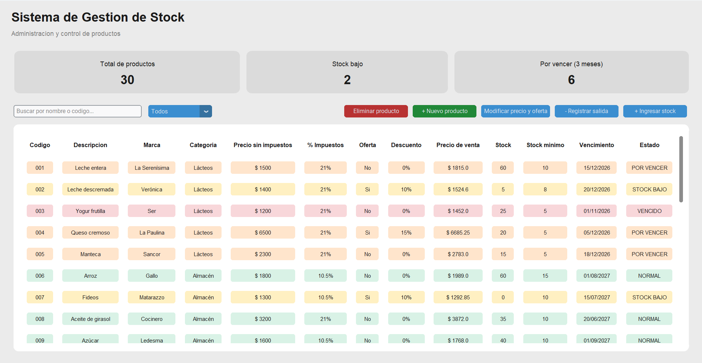

# Sistema de Gestión de Stock e Inventario

**Proyecto académico universitario | Licenciatura en Sistemas de Información Estratégicos – Universidad Nacional de Pilar**

Aplicación de escritorio desarrollada en Python con interfaz gráfica, orientada a la administración de productos y el control de inventarios.

## Descripción

Este proyecto consiste en un sistema de gestión de inventario con interfaz gráfica, diseñado para facilitar la administración de productos, el seguimiento de existencias y el control de vencimientos.

## Vista previa del sistema



## Funcionalidades

- Alta y eliminación de productos.
- Modificación de precios y ofertas.
- Registro de ingresos y egresos de stock.
- Búsqueda por código y descripción.
- Filtros de inventario.
- Control de stock mínimo.
- Seguimiento de productos vencidos y próximos a vencer.
- Cálculo de precios con impuestos y descuentos.
- Almacenamiento de información mediante archivos JSON.

## Tecnologías utilizadas

- Python
- CustomTkinter
- JSON
- Programación orientada a objetos
- Visual Studio Core (entorno de desarrollo)

## Instalación

Instalar las dependencias:

```bash
pip install customtkinter
```

Ejecutar la aplicación:

```bash
python Interfaz.py
```

## Tipo de proyecto

Proyecto académico desarrollado como parte de la Licenciatura en Sistemas de Información Estratégicos.
